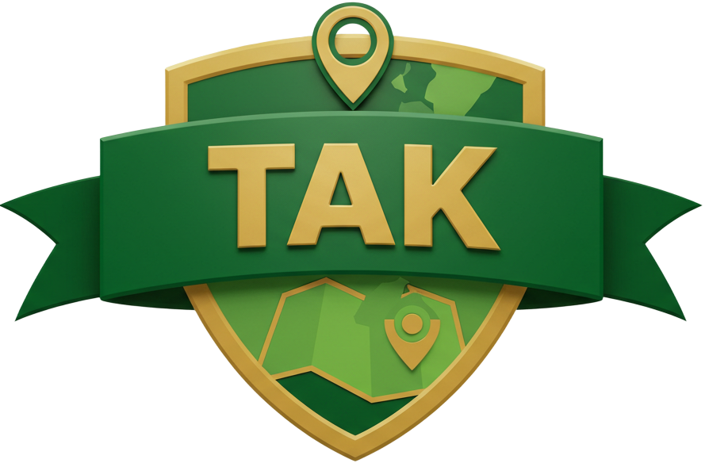

<p align="center">
  
</p>

<h1 align="center">cottak</h1>

<p align="center">
  <b>The Rust toolkit for Cursor on Target (CoT) and TAK.</b><br>
  Build, parse, route and convert CoT for ATAK, WinTAK, iTAK and TAK Server, safely.
</p>

<p align="center">
  <a href="https://github.com/Astute-Systems/cot-tak/actions/workflows/ci.yml"></a>
  <a href="https://github.com/Astute-Systems/cot-tak/actions/workflows/document-ubuntu-22.04.yaml"></a>
  <a href="https://astute-systems.github.io/cot-tak/"></a>
  <a href="#license"></a>
  <a href="https://github.com/Astute-Systems/cot-tak/releases"></a>
  <a href="Cargo.toml"></a>
</p>
<p align="center">
  
  
  
  
  
  
  <a href="https://slsa.dev/spec/v1.0/levels#build-l3"></a>
  <a href="https://github.com/Astute-Systems/cot-tak/actions/workflows/slsa-provenance.yml"></a>
</p>

<p align="center">
  <a href="https://astute-systems.github.io/cot-tak/"><b>Documentation</b></a> &middot;
  <a href="https://astute-systems.github.io/cot-tak/getting-started/quickstart/">Quick start</a> &middot;
  <a href="https://astute-systems.github.io/cot-tak/api/">API reference</a> &middot;
  <a href="https://astute-systems.github.io/cot-tak/concepts/security/">Security model</a> &middot;
  <a href="#complete-feature-list">Features</a>
</p>

> **Status: 2.0.0 release candidate (`v2.0.0-rc1`).** The crate has been rebuilt as a multi-crate
> workspace; the 0.1 API is gone. See [Compatibility and limits](https://astute-systems.github.io/cot-tak/concepts/compatibility/)
> for exactly what has and has not been validated against live ATAK/WinTAK/TAK Server builds.

## Why cottak?

- **One library for the whole TAK stack.** Events, shapes, chat, alerts and MEDEVAC; the XML and
  protobuf wire formats; a resilient TAK Server client; serverless mesh; certificate enrollment;
  the Marti REST API; GeoJSON, KML/KMZ and MIL-STD-2525 conversion; and an embeddable TAK Server
  for your tests. Use one crate or all of them.
- **Safe on untrusted input.** CoT arrives from radios, phones and strangers. Every parser has
  explicit size, depth and count limits, refuses DTDs and custom entities, never panics on
  garbage, and is property-tested and fuzzed.
- **Secure by construction.** TLS is rustls only (no OpenSSL, no C). There is **no way to skip
  server verification**, enrollment never sends credentials to an unverified server, and secrets
  never appear in `Debug` output.
- **Lossless.** Unknown `<detail>` elements and unmodelled attributes survive a parse and write
  round trip, so your gateway does not silently drop what it does not understand.
- **Built to run unattended.** The client reconnects with jittered backoff, detects dead peers,
  upgrades to protobuf on its own, applies backpressure and drops stale events.
- **Testable.** Spin up a real TAK server and the Marti HTTPS API inside `cargo test`, on an
  ephemeral port, and drive your application against it.
- **Documented by compilation.** The guide's code is compiled and run in CI, so the examples
  cannot rot. See the [documentation site](https://astute-systems.github.io/cot-tak/).
- **Permissively licensed core.** `cottak-core` and `cottak-convert` are MIT OR Apache-2.0.
  (The protocol schema crate is the one GPL-3.0 exception; see [License](#license).)

## Complete feature list

<details open>
<summary><b>Events and the data model</b> (<code>cottak-core</code>)</summary>

- Validated `Event`, `Point` (range-checked, NaN/inf rejected, HAE/CE/LE) and `CotType`
  (affiliation, battle dimension, hierarchy queries such as `a-.-G`)
- **Typed details**: contact, group/team, takv, track, status, remarks, precision location, link,
  marti routing, uid, archive, colours, stroke/fill/weight, shapes, ellipses, bullseyes, chat
  and chat receipts, MEDEVAC, emergency, sensor and video
- **Lossless raw details**: anything unmodelled is kept as XML; extend with your own `DetailItem`
- Hardened XML: DTDs and custom entities rejected, 8 MiB / 64-level / 1024-attribute limits,
  control characters refused, hand-written escaping writer that round-trips any text exactly
- Millisecond UTC timestamps, event validation, optional `serde`

</details>

<details open>
<summary><b>Message builders</b></summary>

- **GeoChat**: direct and all-rooms messages, parsing incoming chat
- **Alerts**: 911, ring the bell, troops in contact, geofence breach, and cancel
- **Drawings**: circles, range rings, polygons, geofences, polylines, bullseyes,
  range-and-bearing lines and routes with waypoints, all with colour and weight styling
- **MEDEVAC** requests and **sensor** field-of-view with video links
- **Control**: ping, pong and delete

</details>

<details open>
<summary><b>TAK Protocol v1 (protobuf)</b> (<code>cottak-proto</code>)</summary>

- Event to protobuf mapping per the TAK Protocol specification (typed messages where the mapping
  is exact, `xmlDetail` otherwise, so nothing is lost)
- Streaming (`0xbf <len>`) and mesh (`0xbf <version> 0xbf`) framing: incremental, size-limited
- The `t-x-takp-v/q/r` XML negotiation handshake, client and server sides
- Optional `tokio_util` codec; schemas compiled by a pure-Rust compiler, so **no `protoc`**

</details>

<details open>
<summary><b>TAK Server client and mesh</b> (<code>cottak-net</code>)</summary>

- TCP and **mutual TLS**, automatic **upgrade from XML to protobuf**, keepalive pings, dead-peer
  detection, **jittered exponential reconnect**, bounded queues, stale-event dropping
- Mandatory server authentication: CA files and/or **SHA-256 pinning**; explicit
  trust-on-first-use probe for self-signed servers
- **UDP multicast mesh** for situational awareness and GeoChat, XML or protobuf, with automatic
  format detection on receive

</details>

<details open>
<summary><b>Certificate enrollment</b> (<code>cottak-enroll</code>)</summary>

- `tak://` onboarding links, server subject template, CSR, `signClient/v2` exchange
- ECDSA P-256 generated for you, or **bring your own key (RSA, ECDSA, Ed25519)**
- Identities saved with `0600` key files and no silent overwrite; key/certificate match verified
- **PKCS#12** import and ATAK-compatible export (feature `pkcs12`)
- Credentials only after the server is verified; redirects never followed

</details>

<details open>
<summary><b>Marti REST API</b> (<code>cottak-marti</code>)</summary>

- **Missions**: create, list, fetch, delete, add and remove content, change log,
  subscribe/unsubscribe, subscribers, latest CoT per mission UID
- **File sync**: upload, data-package upload, download by hash
- **People and groups**: contacts, client endpoints, groups, server version and node id
- Mutual TLS or HTTP Basic; typed errors; size limits; tolerant models that keep unknown fields
  and accept epoch or ISO timestamps; endpoints verified against the TAK Server source

</details>

<details open>
<summary><b>Embeddable TAK Server</b> (<code>cottak-server</code>)</summary>

- Plain TCP and (mutual) TLS listeners, XML and protocol v1 with negotiation, ping/pong
- Routing: broadcast, **callsign** (`<marti><dest callsign>`) and **mission** (`<dest mission>`)
- Latest-position replay to new clients, delete handling, observation and injection APIs
- A **Marti HTTPS mock**: missions with contents, change log, subscriptions and passwords; file
  upload/download; contacts, endpoints and groups; optional Basic auth
- Strict, bounded HTTP implementation; bounded clients, queues, stored events and uploads

</details>

<details open>
<summary><b>Conversion and symbology</b> (<code>cottak-convert</code>)</summary>

- **GeoJSON** (RFC 7946, simplestyle) import and export
- **KML 2.2** import and export; import skips what it cannot represent and *reports it*
- **KMZ** read and write (zip-bomb safe, feature `kmz`)
- **MIL-STD-2525B/C** symbol codes to and from CoT types
- Type descriptions from a `CoTtypes.xml` you supply
- Shared geometry rules, circle-to-polygon, great-circle distance and destination helpers

</details>

## Quality you can verify

| Claim | How it is enforced |
|---|---|
| **No `unsafe` code** | `unsafe_code = "forbid"` for the whole workspace |
| **Lint-clean** | `clippy::pedantic` with **zero warnings**, `rustfmt` check, `missing_docs` on public items |
| **Heavily tested** | 330+ tests: unit, property (`proptest`), and integration tests that run the real client against the real server over **mutual TLS with generated certificates** |
| **Fuzzed** | 9 `cargo-fuzz` targets (XML, events, protobuf, mesh, GeoJSON, KML, KMZ, text formats, Marti JSON) with seed corpora; a smoke run on every CI build; every bug found is pinned by a regression test |
| **Hostile-input hardened** | Limits on size, depth, counts and archive expansion; XXE and entity bombs refused; request smuggling vectors refused in the embedded HTTP server |
| **Supply chain checked** | `cargo deny` (advisories, licences, banned crates, sources) and `cargo audit` in CI; OpenSSL and native-tls are banned |
| **Verifiable releases** | Release crate archives carry signed **SLSA Level 3 provenance** built by the [SLSA GitHub generator](https://github.com/slsa-framework/slsa-github-generator); [verify them](https://astute-systems.github.io/cot-tak/concepts/security/#verifying-a-release) with `slsa-verifier` |
| **Portable** | CI on Linux, macOS and Windows; stable, beta and the **MSRV (1.88)** |
| **Docs cannot rot** | Rustdoc built with `-D warnings`; every Rust snippet in the guide is a doctest; site links are checked |
| **Stable error surface** | Errors and events are `#[non_exhaustive]`; secrets are redacted from `Debug` |

Read the [security model](https://astute-systems.github.io/cot-tak/concepts/security/) for the
details of what is and is not protected.

## Quick start

```toml
[dependencies]
cottak = { git = "https://github.com/Astute-Systems/cot-tak", tag = "v2.0.0-rc1", features = ["net"] }
tokio = { version = "1", features = ["rt-multi-thread", "macros"] }
```

```rust
use cottak::core::detail::{Contact, Track};
use cottak::core::{Event, Point};

let event = Event::new("ALPHA-1", "a-f-G-U-C".parse()?, Point::new(-27.4689, 153.0235)?)
    .with(Contact::new("ALPHA-1"))
    .with(Track::new(90.0, 1.5));

let xml = event.to_xml_string()?;
let parsed: Event = xml.parse()?;
assert_eq!(parsed, event);          // lossless round trip
# Ok::<(), cottak::core::Error>(())
```

Send it to a TAK Server and print what comes back:

```rust,no_run
use cottak::net::{ClientConfig, ClientEvent, TakClient, TlsConfig};

let tls = TlsConfig::from_files("ca.pem", Some(("client.pem".as_ref(), "client.key".as_ref())))?;
let (handle, mut events) =
    TakClient::start(ClientConfig::new("tak.example.com:8089", "ALPHA-1").with_tls(tls))?;

handle.send(event).await?;
while let Some(item) = events.recv().await {
    if let ClientEvent::Event(ev) = item {
        println!("{} {}", ev.cot_type, ev.uid);
    }
}
```

Test your application against a real server, in-process:

```rust,no_run
use cottak::server::{Server, ServerConfig};

let server = Server::start(ServerConfig::new().listen_tcp("127.0.0.1:0")).await?;
let addr = server.local_addrs()[0];   // point a `TakClient` here
let mut seen = server.subscribe();    // observe every routed event
```

More in the guide: [messages](https://astute-systems.github.io/cot-tak/guide/messages/),
[enrollment](https://astute-systems.github.io/cot-tak/guide/enrollment/),
[Marti](https://astute-systems.github.io/cot-tak/guide/marti/),
[mesh](https://astute-systems.github.io/cot-tak/guide/mesh/),
[conversion](https://astute-systems.github.io/cot-tak/guide/convert/).

## The crates

Depend on the `cottak` facade and pick features, or depend on a single crate.

| Crate | Facade feature | Purpose |
|---|---|---|
| `cottak-core` | *(always)* | Events, details, XML, message builders |
| `cottak-proto` | `proto` (default), `codec` | TAK Protocol v1, framing, negotiation |
| `cottak-net` | `net` | TAK Server client, TLS, mesh UDP |
| `cottak-enroll` | `enroll`, `pkcs12` | Certificate enrollment |
| `cottak-marti` | `marti` | Marti REST client |
| `cottak-server` | `server` | Embeddable server and Marti mock |
| `cottak-convert` | `convert`, `kmz` | GeoJSON, KML/KMZ, MIL-STD-2525 |
| `cottak` | | Facade; also `serde` |

See [Cargo features](https://astute-systems.github.io/cot-tak/reference/features/) and the
[architecture overview](https://astute-systems.github.io/cot-tak/concepts/architecture/).

## Honest limits

Not implemented: server-side groups/channels and federation, username/password authentication
on the streaming protocol, dynamic per-contact protocol-version tracking on the mesh, the legacy
`signClient` v1 enrollment, RSA key *generation* (supply your own), and MIL-STD-2525D numeric
codes. The message builders and enrollment flow are tested against mocks written from the TAK
Server source and ATAK's documented behaviour, not yet against live ATAK, WinTAK or TAK Server
builds. Details: [Compatibility and limits](https://astute-systems.github.io/cot-tak/concepts/compatibility/).

## Documentation

- **Guide, concepts and security notes:** <https://astute-systems.github.io/cot-tak/>
  (sources in [`docs/`](docs))
- **API reference (rustdoc):** <https://astute-systems.github.io/cot-tak/api/>

## Contributing

Issues and pull requests are welcome. The checks CI runs, the conventions and how to run the fuzzers
are in the [contributing guide](https://astute-systems.github.io/cot-tak/development/contributing/).
Report security problems privately through GitHub
[security advisories](https://github.com/Astute-Systems/cot-tak/security/advisories/new).

## License

Licensed under either of [Apache License 2.0](LICENSE-APACHE) or [MIT license](LICENSE-MIT) at your option.

**Exception: the TAK Protocol schema.** `cottak-proto` bundles `.proto` files derived from
TAK Server, which are licensed under the GPL-3.0 (see
[`crates/cottak-proto/proto/NOTICE.md`](crates/cottak-proto/proto/NOTICE.md)). Anything that links
`cottak-proto` (directly, via `cottak-net`, `cottak-enroll`, `cottak-marti`, `cottak-server`, or the
default `proto` feature of `cottak`) forms a combined work and must comply with the GPL-3.0 for it.
`cottak-core` and `cottak-convert` do not depend on `cottak-proto` and stay MIT OR Apache-2.0 only.

Unless you explicitly state otherwise, any contribution intentionally submitted for inclusion in
this work shall be dual licensed as above, without any additional terms or conditions.
