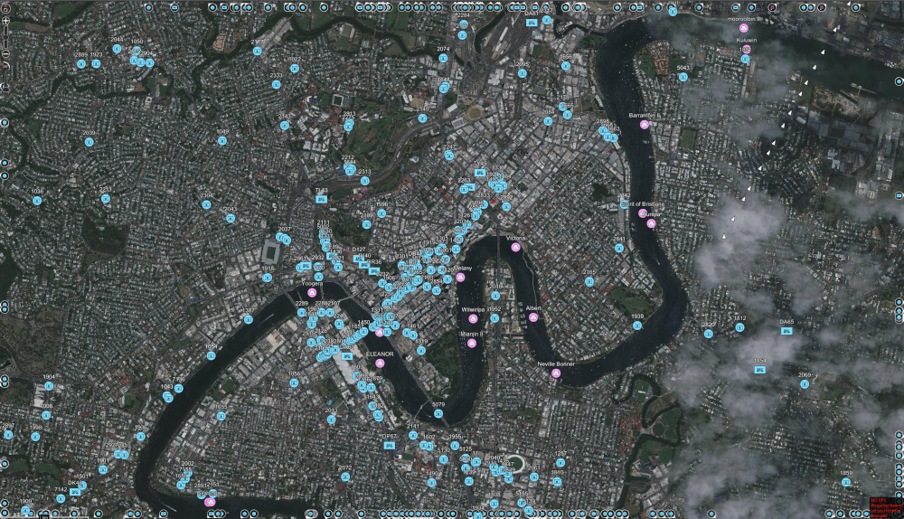
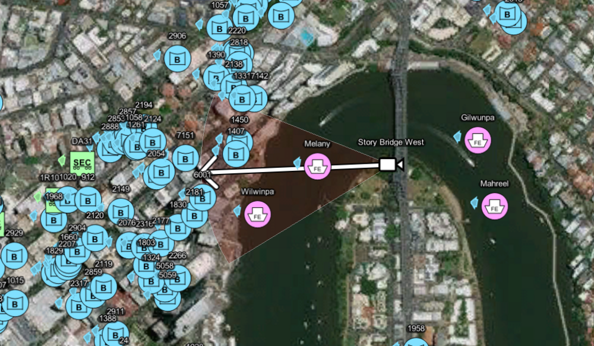

# Cursor On Target (TAK)

[](https://github.com/Astute-Systems/CotX/actions/workflows/build-ubuntu-22.04-amd64.yaml)
[](https://github.com/Astute-Systems/CotX/actions/workflows/build-ubuntu-24.04-amd64.yaml)
[](https://github.com/Astute-Systems/CotX/actions/workflows/document-ubuntu-22.04.yaml)

A selection of utilities for CoT and TAK integration

## Documentation

Documentation is available to view on [Github Pages](https://astute-systems.github.io/CotX/cot)

## Setup and Build

Setup the build environment by running ```./scripts/init_build_machine.sh```.
Build the libraries and example by running ```cargo build```
Copy the config file into host filesystem
```sudo mkdir /etc/cot```
```sudo cp ./cot/config.toml /etc/cot/config.toml```

## Run the example

If built in debug mode, run the following, or change the directory path if built in release mode.

```./target/debug/example```

## Running

Arguments used to set message parameters

``` .bash
./target/release/cot -c HQ_ASTUTE -i ross@astutesys.com
```



# Sensors

A live camera looking out over the river shown in WinTAK


