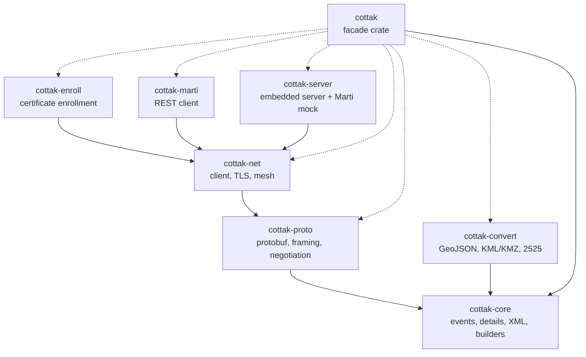
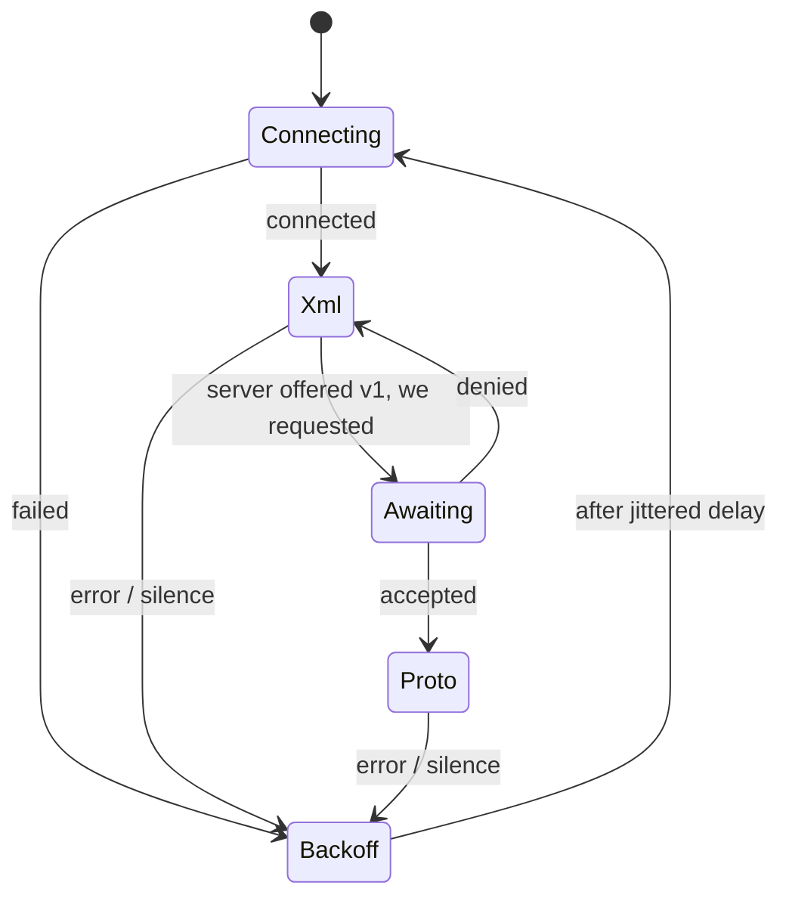
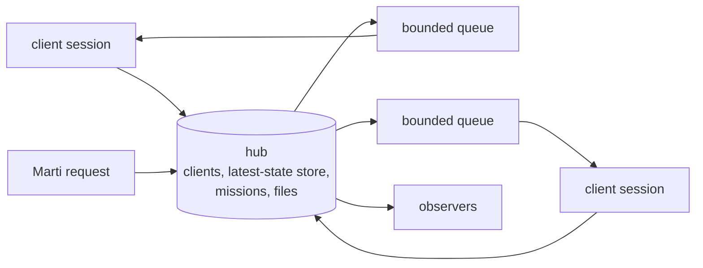

# Architecture

`cottak` is a Cargo workspace of small crates with a one-way dependency graph. The facade crate
`cottak` re-exports them behind features.

Solid arrows are hard dependencies; dotted arrows are optional features of the facade. Only
`cottak-core` and `cottak-convert` are free of the protocol schema's GPL-3.0 licence (see
[Licensing](../reference/licensing.md)).

## Layers

**Model (`cottak-core`).** `Event` plus an ordered list of detail elements. Details are stored as
raw `XmlElement`s; *typed views* (`Contact`, `Track`, ...) read and write them through the
`DetailItem` trait. Because the raw tree is the source of truth, unknown elements and unknown
attributes survive any read-modify-write cycle. The XML writer is hand-written for exact escaping;
the parser is a hardened wrapper around `quick-xml`.

**Wire formats (`cottak-proto`).** Pure functions from `Event` to protobuf and bytes: conversion,
streaming and mesh framing (incremental and size-limited), and the negotiation events. No I/O.

**Transport (`cottak-net`).** A framed `Connection` that speaks XML or protocol v1 over any byte
stream and can switch protocols mid-stream (bytes already buffered are decoded with the new
protocol). The client supervisor and the server's sessions both sit on top of it, as does the
mesh socket.

**Services.** `cottak-enroll` and `cottak-marti` are HTTPS clients (reqwest with the same rustls
configuration as the streaming client). `cottak-server` combines the streaming side and a small
HTTP server around one shared hub.

## The client's life cycle

Each transition out of a connected state is reported as `ClientEvent::Disconnected` with the delay
before the next attempt.

## The server's hub

One lock guards the hub's state; critical sections are short and never await. Each client has a
bounded queue, so a slow client loses events instead of stalling the others. Marti handlers read
and write the same state, which is how contacts, mission routing and mission contents stay
consistent between the two protocols.

## Conventions

- `#![forbid(unsafe_code)]` workspace-wide; `clippy::pedantic` with zero warnings.
- Errors are `thiserror` enums marked `#[non_exhaustive]`; public enums that may grow are too.
- Secrets (keys, passwords) are redacted from `Debug` output.
- Every untrusted input has an explicit limit, defined next to the parser.
