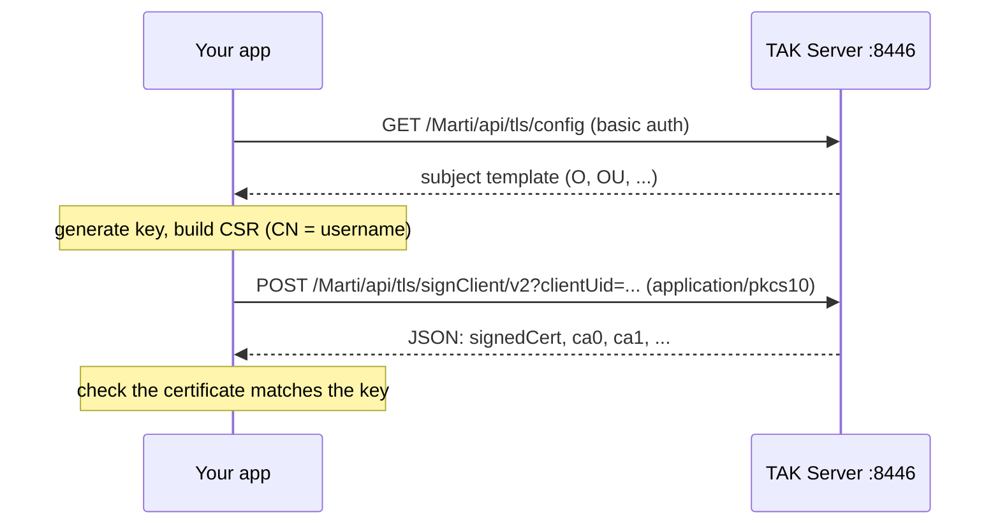

# Enrollment

TAK Servers issue client certificates through an **enrollment** service (default port 8446).
`cottak-enroll` (`cottak::enroll`, feature `enroll`) implements the client side: it understands the
`tak://` onboarding links that QR codes carry, creates a key and a certificate signing request,
has the server sign it and returns an `Identity` you can use for [mutual TLS](client.md#tls).



## Onboarding links

```rust
use cottak::enroll::{Credentials, EnrollmentUrl};

let url = EnrollmentUrl::parse(
    "tak://com.atakmap.app/enroll?host=tak.example.com&username=alice&token=s3cret",
)?;
assert_eq!(url.hostname(), "tak.example.com");

let creds = Credentials::from_url(&url).unwrap();
assert_eq!(creds.username(), "alice");

// Anything that is not a well-formed onboarding link is refused.
assert!(EnrollmentUrl::parse("https://tak.example.com/enroll").is_err());
# Ok::<(), cottak::enroll::Error>(())
```

## Enrolling

You must tell the enroller how to authenticate the server (a CA file or a pinned fingerprint).
**Credentials are sent only after the server is verified**, and redirects are never followed.

```rust,no_run
use cottak::enroll::{Credentials, EnrollConfig, Enroller};
use cottak::net::TlsConfig;

# async fn run() -> Result<(), Box<dyn std::error::Error>> {
let trust = TlsConfig::from_files("server-ca.pem", None)?;
let enroller = Enroller::new(EnrollConfig::new("tak.example.com", trust)).await?;

let identity = enroller
    .enroll(&Credentials::new("alice", "password"), "ANDROID-1234")
    .await?;

identity.save("./certs", "alice")?;      // alice.pem, alice.key, alice-ca.pem
let tls = identity.tls_config()?;        // ready for `ClientConfig::with_tls`
# let _ = tls;
# Ok(()) }
```

`enroll` generates an ECDSA P-256 key. The `client_uid` argument identifies this installation to
the server.

### A self-signed server

Learn its fingerprint with [`probe_server_certificate`](client.md#learning-a-self-signed-servers-fingerprint),
confirm it with the operator, then pin it:

```rust,no_run
use cottak::enroll::{EnrollConfig, Enroller};
use cottak::net::TlsConfig;

# async fn run() -> Result<(), Box<dyn std::error::Error>> {
let trust = TlsConfig::new().with_pinned_sha256_hex("AB:CD:...")?; // from the operator
let enroller = Enroller::new(EnrollConfig::new("tak.example.com", trust)).await?;
# let _ = enroller;
# Ok(()) }
```

### Bring your own key (RSA)

Some deployments only accept RSA. The TLS backend cannot *generate* RSA keys, so create one
yourself and pass it in. It must be an unencrypted PKCS#8 key (`BEGIN PRIVATE KEY`) of at least
2048 bits; ECDSA P-256/P-384 and Ed25519 keys work too.

```sh
openssl genpkey -algorithm RSA -pkeyopt rsa_keygen_bits:3072 -out client.key
```

```rust,no_run
use cottak::enroll::{Credentials, EnrollConfig, Enroller};
use cottak::net::TlsConfig;

# async fn run() -> Result<(), Box<dyn std::error::Error>> {
# let trust = TlsConfig::from_files("server-ca.pem", None)?;
# let enroller = Enroller::new(EnrollConfig::new("tak.example.com", trust)).await?;
let key_pem = std::fs::read_to_string("client.key")?;
let identity = enroller
    .enroll_with_key(&Credentials::new("alice", "password"), "ANDROID-1234", &key_pem)
    .await?;
# let _ = identity;
# Ok(()) }
```

Unusable keys (garbage, PKCS#1 `BEGIN RSA PRIVATE KEY`, RSA under 2048 bits) fail locally, before
any request is made, and the private key is never transmitted. Convert PKCS#1 keys with
`openssl pkcs8 -topk8 -nocrypt`.

## Working with identities

An `Identity` holds the certificate, the private key and the CA certificates the server returned.

- `save(dir, stem)` writes `<stem>.pem`, `<stem>.key` (mode `0600` on Unix) and `<stem>-ca.pem`.
  It **refuses to overwrite** existing files.
- `Identity::load(cert, key, ca)` reads them back and checks that the key matches the certificate.
- `tls_config()` builds a `TlsConfig` that trusts the returned CA; `with_trust(...)` combines the
  identity with a trust configuration you supply (for example a pinned fingerprint).
- `Debug` output redacts the key.

### PKCS#12 (feature `pkcs12`)

ATAK data packages carry certificates as `.p12` files. With the `pkcs12` feature:

```rust,ignore
use cottak::enroll::Identity;

let identity = Identity::from_pkcs12(&std::fs::read("client.p12")?, "atakatak")?;
let bytes = identity.to_pkcs12("atakatak", "alice")?;   // legacy 3DES + HMAC-SHA1, as ATAK expects
```

`atakatak` is the conventional password for TAK-generated packages. The export uses the older
PKCS#12 encryption because that is what ATAK can read.

## Not implemented

- The older `signClient` (v1) endpoint that returns a PKCS#12 bundle.
- Generating RSA keys (see above).
