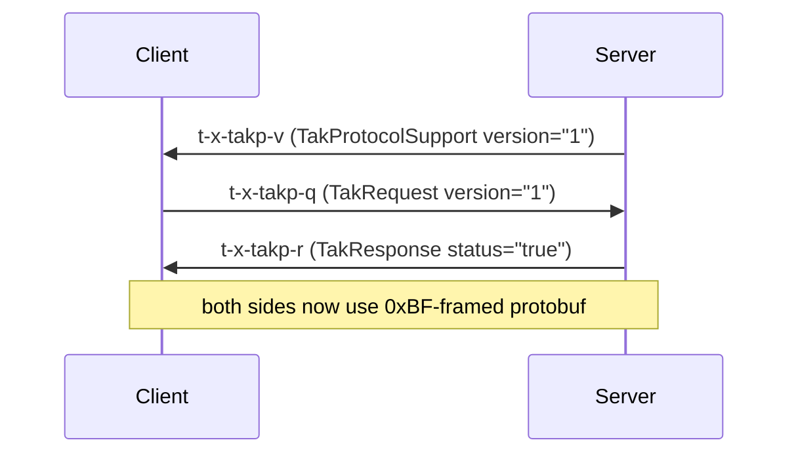

# TAK Protocol v1

TAK Protocol version 1 is a protobuf encoding of CoT that is smaller and cheaper to parse than
XML. `cottak-proto` (re-exported as `cottak::proto`, on by default) converts events to and from
it, frames messages for streams and datagrams, and implements the XML handshake that upgrades a
connection.

If you use the [TAK Server client](client.md) or the [embedded server](server.md), all of this
happens for you. This page is for people building their own transports.

!!! warning "Licence"
    `cottak-proto` bundles schema files derived from TAK Server (GPL-3.0). See
    [Licensing](../reference/licensing.md).

## Wire formats

| Where | Layout |
|---|---|
| **Streaming** (TCP/TLS to a server) | `0xBF` `<varint payload length>` `<protobuf TakMessage>` |
| **Mesh** (UDP datagrams, one-shot TCP) | `0xBF` `<varint version = 1>` `0xBF` `<protobuf TakMessage>` |
| **Legacy XML** (protocol version 0) | `<event>...</event>` elements back to back |

A `TakMessage` carries an optional `TakControl` (the versions the sender understands) and an
optional `CotEvent`. In Rust that is a `TakFrame`:

```rust
use cottak::core::{Event, Point};
use cottak::proto::{Control, TakFrame};

let event = Event::new("U1", "a-f-G-U-C".parse()?, Point::new(1.0, 2.0)?);

// Mesh datagram: one frame per UDP packet.
let datagram = TakFrame::from_event(event.clone()).encode_mesh()?;
assert_eq!(&datagram[..3], &[0xBF, 0x01, 0xBF]);

let decoded = TakFrame::decode_mesh(&datagram)?;
assert_eq!(decoded.event.unwrap().uid, "U1");

// Control information only (no event).
let control = TakFrame::from_control(Control::v1());
assert!(control.event.is_none());
# Ok::<(), Box<dyn std::error::Error>>(())
```

## Streaming: incremental, size-limited decoding

Stream data arrives in arbitrary chunks. `TakFrame::decode_stream` removes one complete frame
from the front of a buffer, returns `Ok(None)` when more bytes are needed, and fails if the
stream is out of sync (bad magic byte, over-long varint) or a frame exceeds your limit:

```rust
use bytes::BytesMut;
use cottak::core::{Event, Point};
use cottak::proto::{frame, TakFrame};

let event = Event::new("U1", "a-f-G-U-C".parse()?, Point::new(1.0, 2.0)?);
let mut wire = BytesMut::new();
TakFrame::from_event(event).encode_stream(&mut wire)?;

// Feed the first half: not enough yet.
let mut buf = BytesMut::from(&wire[..wire.len() / 2]);
assert!(TakFrame::decode_stream(&mut buf, frame::DEFAULT_MAX_FRAME_LEN)?.is_none());

// Feed the rest.
buf.extend_from_slice(&wire[wire.len() / 2..]);
let frame = TakFrame::decode_stream(&mut buf, frame::DEFAULT_MAX_FRAME_LEN)?.unwrap();
assert_eq!(frame.event.unwrap().uid, "U1");

// A frame bigger than the limit is refused before it is buffered.
let mut big = BytesMut::from(&wire[..]);
assert!(TakFrame::decode_stream(&mut big, 4).is_err());
# Ok::<(), Box<dyn std::error::Error>>(())
```

With the `codec` feature, `TakCodec` implements `tokio_util`'s `Decoder` and `Encoder`, so you
can wrap any `AsyncRead + AsyncWrite` in a `Framed`:

```rust
use bytes::BytesMut;
use cottak::core::{Event, Point};
use cottak::proto::TakCodec;
use tokio_util::codec::{Decoder, Encoder};

let mut codec = TakCodec::new().with_max_len(1024 * 1024);
let event = Event::new("U1", "a-f-G-U-C".parse()?, Point::new(1.0, 2.0)?);

let mut buf = BytesMut::new();
codec.encode(event, &mut buf)?;                 // encodes an Event directly
let frame = codec.decode(&mut buf)?.unwrap();   // decodes a TakFrame
assert_eq!(frame.event.unwrap().uid, "U1");
# Ok::<(), Box<dyn std::error::Error>>(())
```

## Negotiation

A streaming connection starts as XML. A server that speaks protocol v1 offers it with a special
event, the client asks for a version, and the server answers. Everything *after* the answer is
protobuf, including bytes that were already buffered.



The `negotiate` module builds and parses these events:

```rust
use cottak::proto::negotiate;

let offer = negotiate::offer("server-uid", &[1])?;
assert_eq!(negotiate::parse_offer(&offer), Some(vec![1]));

let request = negotiate::request("server-uid", 1)?;
assert_eq!(negotiate::parse_request(&request), Some(1));

let accepted = negotiate::response("server-uid", true)?;
assert_eq!(negotiate::parse_response(&accepted), Some(true));
# Ok::<(), cottak::core::Error>(())
```

## How events map to protobuf

The mapping follows the TAK Protocol specification:

- Attributes of `<event>` and `<point>` become fields of `CotEvent`.
- Only elements that map **exactly** onto a typed protobuf message are converted: `contact`,
  `__group`, `precisionlocation`, `status` (battery), `takv` and `track`.
- Everything else, including any element with attributes the protobuf message cannot hold, is kept
  as XML in the `xmlDetail` field, so nothing is lost in translation.

```rust
use cottak::core::detail::Contact;
use cottak::core::xml::XmlElement;
use cottak::core::{Event, Point};
use cottak::proto::TakFrame;

let mut event = Event::new("U1", "a-f-G-U-C".parse()?, Point::new(1.0, 2.0)?)
    .with(Contact::new("ALPHA"));
event.detail.push_raw(XmlElement::new("vendor").with_attr("k", "v"));

let datagram = TakFrame::from_event(event.clone()).encode_mesh()?;
let back = TakFrame::decode_mesh(&datagram)?.event.unwrap();
assert_eq!(back.detail.raw("vendor"), event.detail.raw("vendor"));
# Ok::<(), Box<dyn std::error::Error>>(())
```

## Limits

- Streaming payloads are capped (default 8 MiB, `frame::DEFAULT_MAX_FRAME_LEN`); pass your own
  limit to `decode_stream` or `TakCodec::with_max_len`.
- Mesh decoding accepts only version 1 and rejects datagrams that do not have the exact
  `0xBF <version> 0xBF` header.
- Malformed protobuf is an error, never a panic; the decoders are fuzzed.
